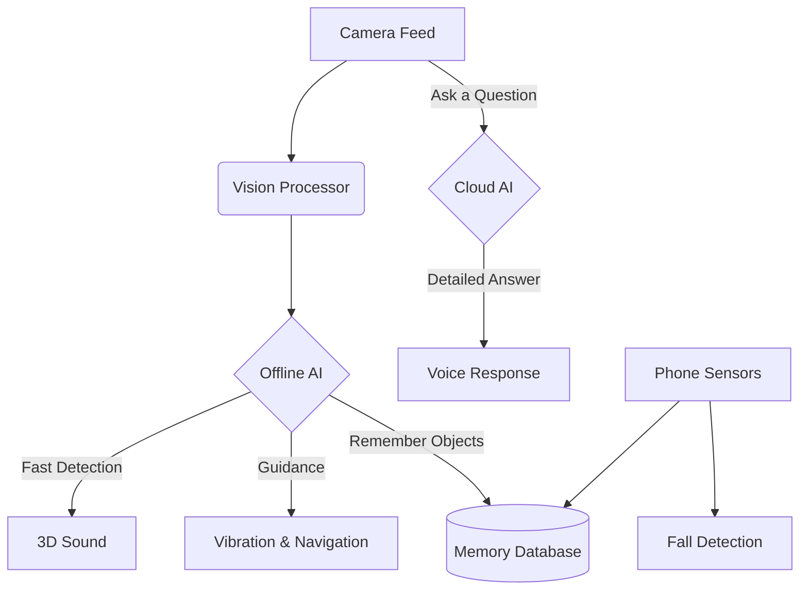
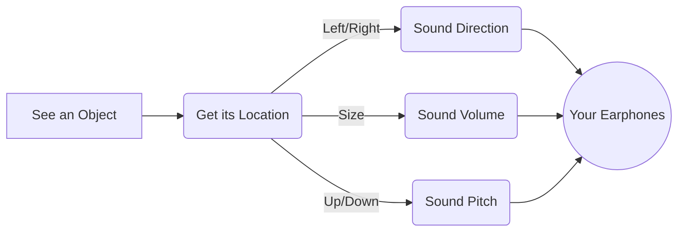
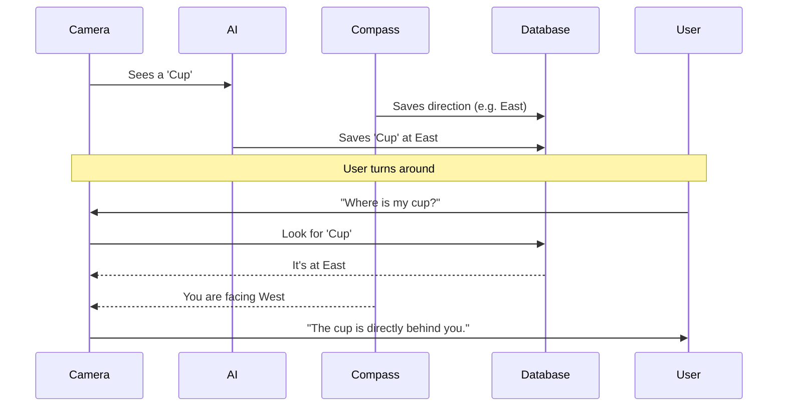
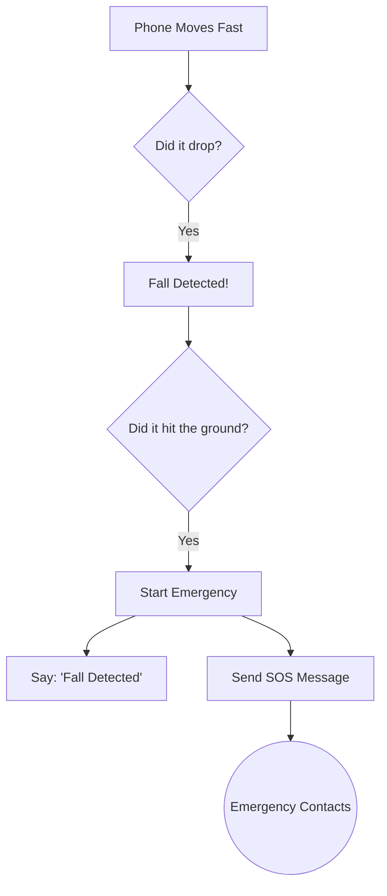

# Vaachak — An Assistive App for the Visually Impaired

  


As part of Hacktoberfest 2026 x Kraftcrowd Hackathon we are building a Offline first Web App + Android App that uses open source gemma models locally 

#### PRESENTATION

https://docs.google.com/presentation/d/11WM5la02aXDbEHukz5thxk6YvKBBeb10_8SE1YJAPOo/edit?usp=sharing

### DEMO VIDEO

Youtube - https://youtu.be/aJADQ3tX5s4

### DEMO URL

Web app Hosted :https://vaachak-ebon.vercel.app/

API endpoint 
https://vaachakfastapibackend.onrender.com/


A smart, voice-controlled Android app that helps visually impaired people navigate their surroundings safely. It acts as an intelligent assistant that can "see" objects, warn about obstacles, and guide the user.

---

## 🌟 What It Can Do

### 🧭 Easy Navigation
*   **🎧 3D Sound Feedback:** The app plays sounds to let you know exactly where objects are around you (left, right, near, or far).
*   **📍 Object Memory:** The app remembers where things are. If you walk past a cup, you can ask "Where is my cup?" and it will tell you.
*   **🔍 Find Mode:** Ask the app to "Find a door" or "Find a chair," and it will guide you to it using sound and vibrations.

### 🧠 Smart Vision
*   **📷 Instant Object Detection:** Uses the phone's camera to instantly spot obstacles and things in your path, without needing the internet.
*   **🖼️ Scene Description:** Ask "Describe what you see," and the app will tell you exactly what the room looks like.
*   **📖 Read Text (OCR):** Point the camera at a sign or book, and it will read the text out loud.
*   **😊 Facial Recognition:** Recognizes people you know when they are nearby and tells you their names.

### 🛡️ Safety First
*   **🎙️ Voice Control:** Control everything using just your voice. No need to look at the screen.
*   **🚨 Fall SOS:** If the phone detects you have fallen, it automatically sends an emergency SOS message to your contacts.
*   **🔦 Manual & Auto-Flashlight:** You can turn the flashlight on and off yourself with a voice command, or let the app do it automatically in the dark so the camera can keep seeing clearly.

---

## 🏗️ How It Works (Diagrams)

### 1. The Big Picture



### 2. How 3D Sound Works



### 3. Remembering Objects



### 4. Emergency Fall Detection



---

## 🛠️ Technology Used

| Part | Tech |
| :--- | :--- |
| **Language** | Kotlin |
| **UI** | Jetpack Compose |
| **Offline AI** | TensorFlow Lite, Google ML Kit |
| **Online AI** | Vaachak Render API (Gemma, Sarvam, Backboard, Supabase) |
| **Database** | Room (SQLite) |

---

## 🚀 How to Run It

1. **Download** this code to your computer.
2. Open it in **Android Studio**.
3. Let it finish loading.
4. The app uses `https://vaachakfastapibackend.onrender.com/` by default. To change it, set an HTTPS `VAACHAK_API_URL` in `app/.env` or root `local.properties`. Legacy `app/src/.env` is also loaded and takes precedence over `app/.env`, which takes precedence over root `local.properties`. Remove stale HTTP overrides before syncing; local frontend access uses the separate `frontend` variant. Provider keys stay on the backend. Telegram alerts still use `TELEGRAM_BOT_TOKEN` and `TELEGRAM_CHAT_ID` in root `local.properties`.
5. **Run** it on a real Android phone (the camera and sensors won't work properly on an emulator).

---

## 🗣️ Voice Commands to Try

*   🗣️ *"Describe what you see"*
*   🗣️ *"Find a chair"*
*   🗣️ *"Where is my cup?"*
*   🗣️ *"Read"*
*   🗣️ *"Turn off flashlight"*
*   🗣️ *"Switch to spatial"* (for 3D sound)
*   🗣️ *"Start eye test"* (for visual acuity calibration)

---

## 🏆 Hackathon Tracks & Gemma Integration

As part of **Hacktoberfest 2026 x Kraftcrowd Hackathon**, **Vaachak** is built as an offline-first assistive Android application leveraging open-source Gemma & NVIDIA AI models.

### Track 1: Best Use of Gemma Model
* **G2. Voice-First AI Interaction**: Integrate voice-based intelligence that lets visually impaired users interact naturally through speech, evaluate acuity, and receive spoken audio responses.
* **G3. Multimodal AI Intelligence**: Combines real-time camera imagery, optical character recognition (OCR), spatial 3D audio, and spoken voice inputs to understand surroundings and guide users.
* **G5. Open Innovation with Gemma 4**: Powered by NVIDIA AI / Gemma vision & language models for clinical visual acuity scoring and real-time scene understanding.

### Resources
* [Gemma 4 Resources & Overview](https://mlh.link/gemma)
* [Gemma Quickstart](https://mlh.link/gemma-quickstart)
* [Gemma API Documentation](https://mlh.link/gemma-docs)
* [Gemma Beginner Guide](https://mlh.link/gemma-beginnerguide)
[Using Gemma Model with Gemini](https://ai.google.dev/gemma/docs/core/gemma_on_gemini_api)


### Open source Tools we are using 

-> OpenCode -> For Code Generation
-> OpenDesign -> For Design Generation 
-> Ollama -> For hosting local Gemma Models

For coding 

We are using OpenCode with Qwen 3.6:latest model locally


MCP Servers Used:

https://devrelay.com
https://github.com/github/github-mcp-server

ARMORIQ


## Android cloud integration

Open **Help → Open Cloud API Playground** for all deployed API operations. Select an operation, edit the JSON body, and send. Image and audio operations use the Android file picker (10 MB limit). TTS responses have a Play button. HTTP failures, service-level failures, and partial voice responses are shown explicitly.

- Surroundings offline mode now blocks cloud descriptions and accurately identifies the bundled YOLO/ML Kit tools. Scene descriptions and AI eye-test evaluation now call Render. The eye-test evaluator retains its existing local fallback. Text Reader offers both the existing on-device OCR button and **Read with Cloud AI**.
- The native speech recognizer and Android TTS remain available for offline guidance. Cloud Sarvam STT/TTS and voice-first are explicitly tested in the playground using uploaded audio.
- Database workflow: Create user → Save/load preferences → Create conversation → Append/read messages. Returned user/conversation IDs populate automatically. Preferences and messages here are explicit test data; the playground does not automatically change the app's accessibility settings or upload all app interactions.
- Memory workflow: Memory message creates an assistant/thread; `send_to_llm: "false"` stores context without LLM generation. Reuse the IDs for add/list/search memory. Enter an operation ID for operation status. New thread preserves assistant memory.
- Only resource IDs persist on-device. Request/response bodies are held in screen memory. The app-session journey records the last 100 paths, statuses, and durations without payloads or credentials. Android logs are separate from the web playground's browser-local logs.
- Ollama is not exposed by the deployed OpenAPI schema and is not routed through Render.
- The current database routes use backend service credentials and have no user authentication. The playground is for integration testing; selected UUIDs do not establish an authenticated identity.

Validation: `./gradlew :app:assembleDebug :app:testDebugUnitTest :app:lintDebug` with Android SDK 35 and Java 17. API transport tests use MockWebServer for response envelopes, multipart names, HTTP/semantic errors, cancellation, and logs. No cloud keys are needed for these unit tests. Live validation results are in `render-test-results.json`; labeled synthetic test records are retained for inspection.

## Android Studio: connect to the Next.js frontend

Open this repository root in Android Studio, sync Gradle, then choose **app → frontend** in Build Variants and run it on the emulator. The separately installed **Vaachak Frontend** app uses `http://10.0.2.2:3000/` (the emulator's alias for your Mac). Start the existing `cloud-ai-client` with `npm run dev` first.

Routing: `/api/gemini/*`, `/api/sarvam/*`, `/api/backboard/*`, `/api/health`, and `/api/voice-first` go through `/api/backend/*`; `/api/db/*` maps to `/api/database/*`; Ollama uses `/api/ollama/*`. Next.js's `VAACHAK_API_URL` controls whether cloud/database requests go to your local Python server or Render. `OLLAMA_API_URL` controls the local Ollama server. Provider credentials stay server-side.

In **Help → Open Cloud API Playground**, the frontend variant adds Ollama models, generation, chat, and embeddings. Use **Load and choose local model** before sending an Ollama request. Android requests appear in the Android session journey; the web Logs page records only browser-originated requests.

The normal **debug** variant still calls Render directly. Local HTTP is allowed only for loopback/emulator addresses in the frontend variant; release security is unchanged. For a USB phone, run `adb reverse tcp:3000 tcp:3000` and build with `-PvaachakFrontendUrl=http://127.0.0.1:3000/`.

Frontend validation: `./gradlew :app:assembleFrontend :app:testFrontendUnitTest :app:lintFrontend`. APK: `app/build/outputs/apk/frontend/app-frontend.apk`.

### Live Render tests on Android

The `app/src/androidTest` suite includes opt-in tests using the real Android client against Render: text/chat, generated test-image OCR, TTS → STT → voice-first, database preferences/conversation persistence, Backboard memory APIs, and Compose UI navigation to a successful Render health response.

Run from Android Studio's project terminal with an emulator connected:

```sh
./gradlew :app:connectedDebugAndroidTest -Pandroid.testInstrumentationRunnerArguments.liveRender=true
```

These tests make small real provider requests and create labeled synthetic database and memory records. Without `liveRender=true`, the live tests are skipped. The regular `debug` APK connects directly to Render; `frontend` is the separate local Next.js integration build.
